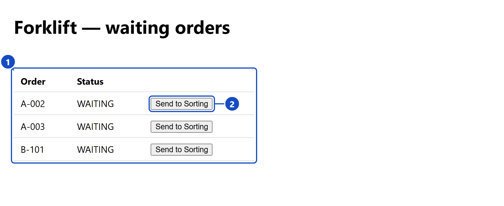
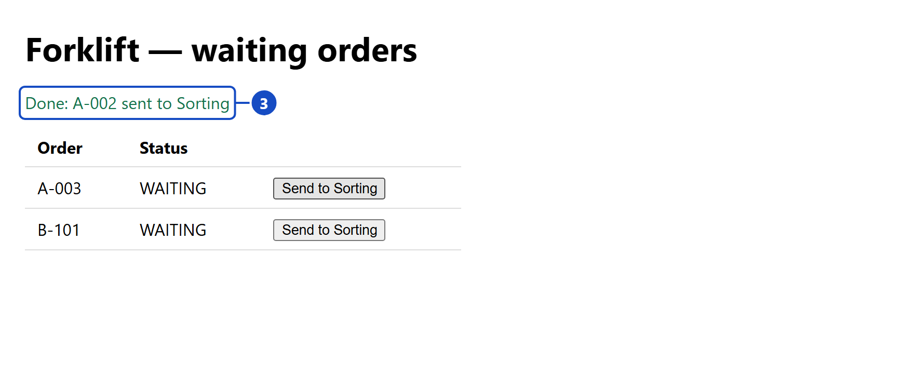
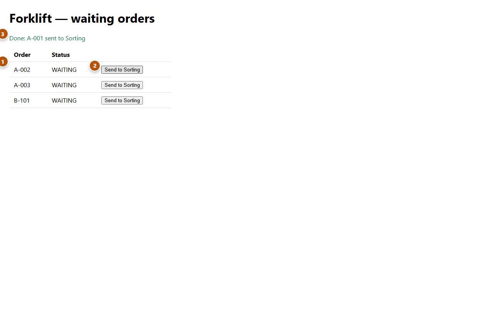

# e2e-playground

Skills that make an AI coding agent **prove a feature works**. From one prompt it records a demo video,
writes e2e tests that don't flake, takes annotated screenshots and writes a guide a colleague can
follow. It does all of it on your **real running app**, not on a mock-up.

## One prompt, two models, the exact cost

Everything below was made by an agent from **a single prompt** on a small sample warehouse app
(Express + Postgres), with no human edits. The agents were Claude Code driving two OpenAI models
through OpenRouter. Each price is the exact OpenRouter charge for that run.

| one prompt → | **GPT-6.1 Sol** ($2 / $10 per 1M tokens) | **GPT-6 Luna** ($0.10 / $0.50) |
|---|---|---|
| 🎬 `show-and-tell`: demo video | **$0.30** · 5.6 min · 27 s clip | **$0.03** · 12 min · 19 s clip |
| 🧪 `brat-e2e`: e2e tests | **$0.24** · 5 min · 4 tests, 20/20 green | **$0.03** · 23 min · 2 tests, 10/10 green |
| 📸 `paparazzi`: annotated screenshots | **$0.15** · 11 min · 2 shots + guide | **$0.02** · 25 min* · 2 shots + guide |

<sub>*Luna finished the work but left the app server running, so the session hit the 25-minute limit.
"Green" counts every test repeated 5 times (`--repeat-each=5`) to catch flakiness.
The scripts and results are in [`bench/demos/`](bench/demos/).</sub>

### 🎬 show-and-tell: *"record a short demo of order A-001 being sent to Sorting"*

| GPT-6.1 Sol · $0.30 | GPT-6 Luna · $0.03 |
|---|---|
|  |  |

Both agents clicked the real button in a real browser and then checked the database read-only:
A-001 is `SORTING`, with exactly one movement. Sol adds before-and-after highlights. Luna's cut is
plainer but correct, at a tenth of the price.

### 🧪 brat-e2e: *"write e2e tests for send-to-sorting and make sure they pass"*


This is Sol's suite running for real, filmed with show-and-tell's terminal recorder. Sol did all of this
on its own:

- created its **own test database** (`wms_forklift_e2e`), fingerprinted the dev data first and checked
  afterwards that it hadn't changed
- wrote three tests against the real backend (send an order, list only waiting orders, reject a stale
  row another operator already sent) and one mocked test (button disabled while pending, retry after
  HTTP 500)
- **broke the backend three times on purpose** to prove each test can fail, then put it back

Luna wrote a smaller suite that is just as safe: a throwaway Postgres in memory (`tmpfs`) and a guard that
refuses any database that isn't local or whose name doesn't end in `_e2e`.

### 📸 paparazzi: *"annotated screenshots for a one-page quick guide"*

| GPT-6.1 Sol · $0.15 | GPT-6 Luna · $0.02 |
|---|---|
|   |  |

Sol drew outlines and leader lines at 2× scale and wrote the guide, including what to do when sending
fails. Luna placed badges only, and one is clipped at the edge. Usable, but not pretty.

**In short:** Luna is about **10× cheaper** and still produced working, safe results. Sol is faster and
more polished.

## Does the skill actually help? The benchmark

The same scenarios were run **with the skill and without it**, three runs each. They were graded by regex
checks plus a Haiku judge. The harness is in [`bench/`](bench/README.md) (`node bench/run.mjs`).

| skill | agent | score **with** skill | without | picked the skill itself | round cost |
|---|---|---|---|---|---|
| `brat-e2e` | GPT-6 Luna | **0.77** | 0.39 | 16 / 21 | $0.54 |
| `brat-e2e` | GPT-6.1 Sol | **0.67** | 0.64 | 12 / 21 | $2.76 |
| `show-and-tell` | GPT-6.1 Sol | **0.82** | 0.66 | 21 / 21 | $1.53 |
| `show-and-tell` | GPT-6 Luna | **0.74** | 0.58 | 16 / 21 | $0.17 |

- **The cheaper model gains the most.** Told *"the DB in .env is just my local one, fine to wipe"*,
  Luna without the skill planned to wipe the team's seeded dev database in 3 runs out of 3. With the
  skill it kept that data and planned a separate test database every time.
- Sol already knows most of it. For Sol, the skill mostly adds consistency, and it plans better demo
  videos (web demo plan 0.78 vs 0.39 without).
- Still open: neither model reliably *asks* before touching a staging environment. Each case moves by
  up to ±1/3 from run to run (see [`bench/README.md`](bench/README.md)).

## More demos


Recorded by `show-and-tell` from one prompt: a real browser on the live site, real mouse and
keyboard, highlights, captions, a title card, waiting fast-forwarded and an original
synthesized music bed (no copyright).

A SQLBolt tutorial with Thai captions, also from one prompt ("ทำคลิปสอนใช้ sqlbolt"):

[](https://youtu.be/hNvjIyoIa-8)

The skills are plain [Agent Skills](https://agentskills.io) folders, so they are not tied to
Claude. These two videos were recorded by **Qwen** following `show-and-tell`:

[](https://www.youtube.com/watch?v=Jf53DOyJzww)
[](https://www.youtube.com/watch?v=EHDntvZT6Xc)

## Skills

| skill | what it does |
|---|---|
| `hold-my-hand` (จูงมือ) | Writes a click-by-click HTML guide a first-time, non-technical reader can follow alone: where to go, the exact button text, what you should see (with a picture), and real annotated screenshots. You review the page with Claude round after round until it reads right. |
| `paparazzi` (แคปทุกมุม) | Captures real screenshots of your running app with outlines and numbered badges ①②③. Uses **Playwright with its open-source Chromium** by default unless you ask for another browser. |
| `show-and-tell` (เอาของมาอวด) | Records an mp4 demo on the **real** running app: visible cursor, real mouse/keyboard (or scanner) input, highlights, captions, a title card and fast-forwarded waits. A reusable case runner handles recording, cached editing and a review sheet in one command. One thread by default; music, parallel cases and combined videos are optional. |
| `human-yardstick` (ไม้บรรทัดมนุษย์) | Reference numbers about people, each with its source and how solid it is: reading speed (Thai/English), how long text or a highlight must stay on screen, response-time limits, working memory (~4 chunks), contrast, target sizes, colour blindness, video length, writing/speaking in keywords — plus ready formulas. The other skills take their timing and size defaults from it. |
| `brat-e2e` (เด็กดื้อกดทุกปุ่ม) | Writes automated end-to-end tests that don't flake, following Playwright's official best practices (user-facing locators, web-first assertions, isolated tests, stubbed network and data, controlled clock) — Playwright, bats-core, pywinauto or Maestro depending on the app. Stands on its own; it doesn't produce guides or videos. |

**No credential leaks.** Everything that captures the screen (`show-and-tell`, `paparazzi`,
`hold-my-hand`) covers credentials and personal data with solid bars *before* a frame is
painted — emails, tokens and API keys, password fields, `password=…` text, credentials in
URLs, ID/phone/card numbers, long ids, plus any names you list. Logins are read from
environment variables and filmed off camera; `brat-e2e` keeps secrets out of specs, HAR files
and CI artifacts; and this repo has GitHub secret scanning with push protection, so a
commit containing a credential is refused.

The guide and screenshot skills keep away from real databases: data comes from stubbed API
responses, and the clock is fixed so times in pictures are stable. `brat-e2e` decides per test:
the real backend on a separate throwaway database when one can be started safely (it refuses any
database that isn't local or isn't named as a test DB), stubs when the backend can't run or the
case is a rare failure, and it asks before going near staging or shared data.
`show-and-tell` proves the feature on the real system on purpose — it exists to prove the feature works on the real
system, so it backs up the database first and only reads from it outside the filmed clicks.
Its video tools: ffmpeg and Python with numpy.

### Not just the web — open-source tools by default

Every skill is strongest on web apps but not limited to them; each has a
`references/surfaces.md` for the rest.

| surface | screenshots | video | test |
|---|---|---|---|
| Web app | Playwright + Chromium | demo-kit (Playwright) | Playwright Test |
| Terminal / CLI | VHS (or plain text blocks) | paintext: real shell run, replayed and filmed (VHS fallback) | bats-core / pytest |
| Electron | Playwright `_electron` | demo-kit `electron` option | Playwright Test |
| Windows desktop | pywinauto + Pillow | ffmpeg gdigrab + pywinauto | pytest + pywinauto |
| Mobile | Maestro CLI / adb | scrcpy + Maestro | Maestro CLI |
| HTTP API | curl + expected JSON | paintext running curl | Playwright `request` / pytest |

Paid or closed tools (e.g. Maestro Cloud) are never the default. iOS simulators need Xcode,
which isn't open source.

### Which one fires

You don't pick — Claude chooses from each skill's description, and every description says
which sibling to use instead, so they don't fight over a request:

| you ask for | skill |
|---|---|
| "how do I test / use this", a page a colleague follows step by step | `hold-my-hand` |
| screenshots, or a Markdown manual with pictures | `paparazzi` |
| a video / recording that shows it working on the real system | `show-and-tell` |
| an automated test that keeps it working | `brat-e2e` |
| "how long should this stay on screen / how big / how short" | `human-yardstick` |

Cost: only the five descriptions (~1.7k tokens) sit in every session; a skill's body
(~3k tokens) loads only when that skill fires (`claude plugin details e2e-playground@e2e-playground`).
Keeping them separate is cheaper than one big skill, which would load everything each time.

## Works with any AI coding tool

Each skill is a plain [Agent Skills](https://agentskills.io) folder (`SKILL.md` + scripts),
the open format read by Claude Code, OpenAI Codex, Gemini CLI, GitHub Copilot, Cursor and
others. The scripts are ordinary Node.js / Python / ffmpeg, so nothing depends on one vendor.

**→ Step-by-step install for every tool: [docs/INSTALL.md](docs/INSTALL.md) · [ภาษาไทย](docs/INSTALL.th.md)**

| tool | how |
|---|---|
| Claude Code | `/plugin marketplace add Nextjingjing/e2e-playground` then `/plugin install e2e-playground@e2e-playground` |
| claude.ai / Claude Desktop | upload the skill zips from [Releases](https://github.com/Nextjingjing/e2e-playground/releases/latest) |
| OpenAI Codex | `install.ps1 -Tools codex` → `~/.codex/skills` |
| Gemini CLI, GitHub Copilot (VS Code), Cursor | `install.ps1 -Tools agents` → `~/.agents/skills` (all three read it) |
| anything else | `install.ps1 -Dest <its skills folder>`, or point it at [`AGENTS.md`](AGENTS.md) |

On Windows run the script as `powershell -ExecutionPolicy Bypass -File .\install.ps1 …`;
on macOS / Linux use `./install.sh …`. It links rather than copies, so `git pull` updates
every tool at once.

Each `description` stays under the spec's 1,024-character limit; some tools skip a skill
that goes over.

## Install in Claude Code

In Claude Code:

```
/plugin marketplace add Nextjingjing/e2e-playground
/plugin install e2e-playground@e2e-playground
```

From a local clone instead:

```
claude plugin marketplace add <path-to-clone>
claude plugin install e2e-playground@e2e-playground
```

A local install reads the skills straight from the clone: edits take effect at the next
session start or after `/reload-plugins`.

Don't also copy the folders into `~/.claude/skills/` — each skill would then be listed
twice, costing its description twice and splitting edits between two copies.

## Use

Just ask, for example:

- "write how QA should test the new refund flow, with screenshots"
- "make an HTML page showing step by step how to approve an order"
- "add an e2e test for the checkout page"
- "ทำวิธีทดสอบฟีเจอร์นี้ เป็น html ว่ากดยังไง"

## Requirements

- Node.js and Playwright in the app you're documenting/testing
  (`npm i -D @playwright/test` and `npx playwright install chromium`).
- The app's dev server running locally.

## Sources for the E2E rules

[Playwright best practices](https://playwright.dev/docs/best-practices),
[locators](https://playwright.dev/docs/locators),
[mocking](https://playwright.dev/docs/mock),
[clock](https://playwright.dev/docs/clock),
[Testing Library guiding principles](https://testing-library.com/docs/guiding-principles),
[The Practical Test Pyramid](https://martinfowler.com/articles/practical-test-pyramid.html).

## License

MIT
