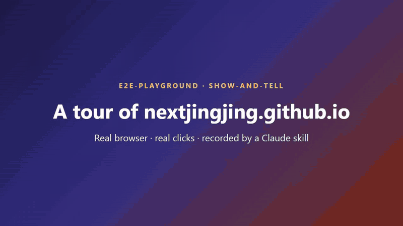

# e2e-playground

Claude Code skills for **guides anyone can follow**, **screenshots**, **demo videos**,
**tests that don't flake** and **numbers about people** — five kids in one end-to-end
playground.

## Demo



Recorded by `show-and-tell` from one prompt: a real browser on the live site, real mouse and
keyboard, highlights, captions, a title card, fast-forwarded waiting and an original
synthesized music bed (no copyright). Full 1-minute video: *YouTube link coming soon*.

## Skills

| skill | what it does |
|---|---|
| `hold-my-hand` (จูงมือ) | Writes a click-by-click HTML guide a first-time, non-technical reader can follow alone: where to go, the exact button text, what you should see (with a picture), and real annotated screenshots. You review the page with Claude round after round until it reads right. |
| `paparazzi` (แคปทุกมุม) | Captures real screenshots of your running app with outlines and numbered badges ①②③. Uses **Playwright with its open-source Chromium** by default unless you ask for another browser. |
| `show-and-tell` (เอาของมาอวด) | Records an mp4 demo on the **real** running app, clicked like a person: visible cursor, real mouse/keyboard (or scanner) input, highlights, captions, a title card per case, slow at the key moments and fast-forwarded through spinners, with an original synthesized music bed. One video per case plus a combined one; cases can be recorded in parallel by subagents. |
| `human-yardstick` (ไม้บรรทัดมนุษย์) | Reference numbers about people, each with its source and how solid it is: reading speed (Thai/English), how long text or a highlight must stay on screen, response-time limits, working memory (~4 chunks), contrast, target sizes, colour blindness, video length, writing/speaking in keywords — plus ready formulas. The other skills take their timing and size defaults from it. |
| `brat-e2e` (เด็กดื้อกดทุกปุ่ม) | Writes automated end-to-end tests that don't flake, following Playwright's official best practices (user-facing locators, web-first assertions, isolated tests, stubbed network and data, controlled clock) — Playwright, bats-core, pywinauto or Maestro depending on the app. Stands on its own; it doesn't produce guides or videos. |

The guide, screenshot and test skills keep away from real databases: data comes from
stubbed API responses, and the clock is fixed so times in pictures and tests are stable.
`show-and-tell` is the exception on purpose — it exists to prove the feature works on the real
system, so it backs up the database first and only reads from it outside the filmed clicks.
Its video tools: ffmpeg and Python with numpy.

### Not just the web — open-source tools by default

Every skill is strongest on web apps but not limited to them; each has a
`references/surfaces.md` for the rest.

| surface | screenshots | video | test |
|---|---|---|---|
| Web app | Playwright + Chromium | demo-kit (Playwright) | Playwright Test |
| Terminal / CLI | VHS (or plain text blocks) | VHS → mp4 | bats-core / pytest |
| Electron | Playwright `_electron` | demo-kit `electron` option | Playwright Test |
| Windows desktop | pywinauto + Pillow | ffmpeg gdigrab + pywinauto | pytest + pywinauto |
| Mobile | Maestro CLI / adb | scrcpy + Maestro | Maestro CLI |
| HTTP API | curl + expected JSON | VHS running curl | Playwright `request` / pytest |

Paid or closed tools (e.g. Maestro Cloud) are never the default. iOS simulators need Xcode,
which isn't open source.

### Which one fires

You don't pick — Claude chooses from each skill's description, and every description says
which sibling to use instead, so they don't fight over a request:

| you ask for | skill |
|---|---|
| "how do I test / use this", a page a colleague follows step by step | `hold-my-hand` |
| screenshots, or a Markdown manual with pictures | `paparazzi` |
| a video / recording that shows it working on the real system | `show-and-tell` |
| an automated test that keeps it working | `brat-e2e` |
| "how long should this stay on screen / how big / how short" | `human-yardstick` |

Cost: only the five descriptions (~1.7k tokens) sit in every session; a skill's body
(~3k tokens) loads only when that skill fires (`claude plugin details e2e-playground@e2e-playground`).
Keeping them separate is cheaper than one big skill, which would load everything each time.

## Works with any AI coding tool

Each skill is a plain [Agent Skills](https://agentskills.io) folder (`SKILL.md` + scripts),
the open format read by Claude Code, OpenAI Codex, Gemini CLI, GitHub Copilot, Cursor and
others. The scripts are ordinary Node.js / Python / ffmpeg, so nothing depends on one vendor.

**→ Step-by-step install for every tool: [docs/INSTALL.md](docs/INSTALL.md) · [ภาษาไทย](docs/INSTALL.th.md)**

| tool | how |
|---|---|
| Claude Code | `/plugin marketplace add Nextjingjing/e2e-playground` then `/plugin install e2e-playground@e2e-playground` |
| claude.ai / Claude Desktop | upload the skill zips from [Releases](https://github.com/Nextjingjing/e2e-playground/releases/latest) |
| OpenAI Codex | `install.ps1 -Tools codex` → `~/.codex/skills` |
| Gemini CLI, GitHub Copilot (VS Code), Cursor | `install.ps1 -Tools agents` → `~/.agents/skills` (all three read it) |
| anything else | `install.ps1 -Dest <its skills folder>`, or point it at [`AGENTS.md`](AGENTS.md) |

On Windows run the script as `powershell -ExecutionPolicy Bypass -File .\install.ps1 …`;
on macOS / Linux use `./install.sh …`. It links rather than copies, so `git pull` updates
every tool at once.

Each `description` stays under the spec's 1,024-character limit; some tools skip a skill
that goes over.

## Install in Claude Code

In Claude Code:

```
/plugin marketplace add Nextjingjing/e2e-playground
/plugin install e2e-playground@e2e-playground
```

From a local clone instead:

```
claude plugin marketplace add <path-to-clone>
claude plugin install e2e-playground@e2e-playground
```

A local install reads the skills straight from the clone: edits take effect at the next
session start or after `/reload-plugins`.

Don't also copy the folders into `~/.claude/skills/` — each skill would then be listed
twice, costing its description twice and splitting edits between two copies.

## Use

Just ask, for example:

- "write how QA should test the new refund flow, with screenshots"
- "make an HTML page showing step by step how to approve an order"
- "add an e2e test for the checkout page"
- "ทำวิธีทดสอบฟีเจอร์นี้ เป็น html ว่ากดยังไง"

## Requirements

- Node.js and Playwright in the app you're documenting/testing
  (`npm i -D @playwright/test` and `npx playwright install chromium`).
- The app's dev server running locally.

## Sources for the E2E rules

[Playwright best practices](https://playwright.dev/docs/best-practices),
[locators](https://playwright.dev/docs/locators),
[mocking](https://playwright.dev/docs/mock),
[clock](https://playwright.dev/docs/clock),
[Testing Library guiding principles](https://testing-library.com/docs/guiding-principles),
[The Practical Test Pyramid](https://martinfowler.com/articles/practical-test-pyramid.html).

## License

MIT
